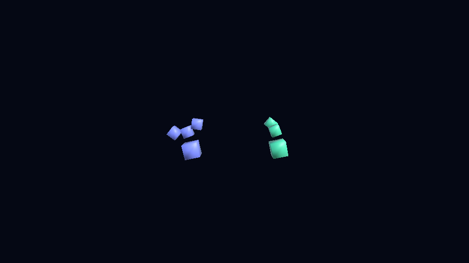
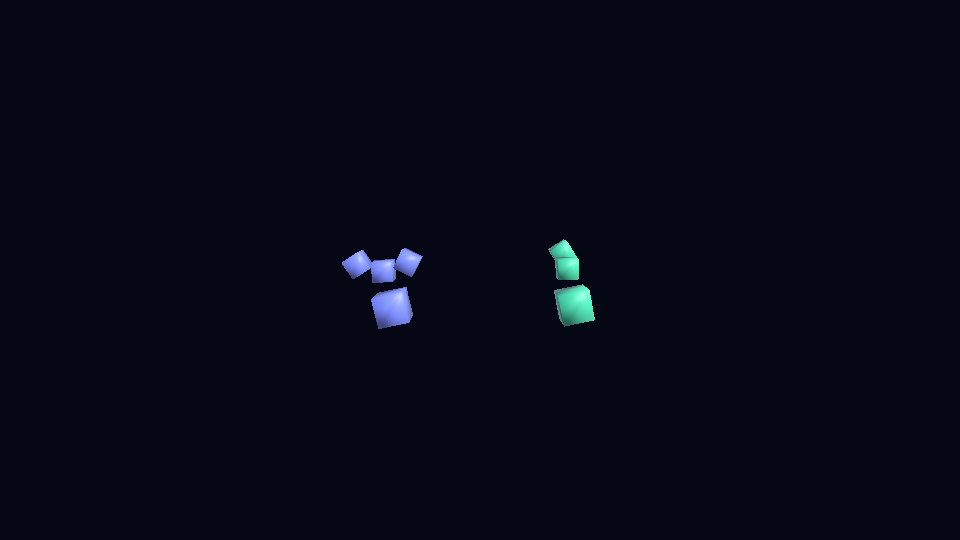

# Native Unity qualification — 23 October 2026

The root Git package was tested in a fresh consumer built from the installed Unity URP template, with all four opt-in samples imported and package `testables` enabled. The actual host was Unity **6000.6.7f1**, URP **17.6.0**, Test Framework **1.8.0**, Windows, Direct3D 11 and **NVIDIA GeForce RTX 4060 Ti**. This is a bounded preview qualification, not an assertion about every Unity version or platform.

| Gate | Observed result |
| --- | --- |
| Native EditMode suite | 23 passed including the generated-rig integration regression; no failures, skips or inconclusive cases |
| Native PlayMode suite | Five passed, including GPU framebuffer readback and fixed/variable-tempo seeks |
| Generated synthetic rig scene | Saved and reopened with persistent meshes, materials, avatar and recording/profile bindings |
| Direct and Playables skinning | Actual baked vertex positions changed by maxima of 0.3432 and 0.3323 Unity units respectively between source times 0.1 and 0.6 seconds |
| Recording exhaustion | Both players stopped sampling beyond the 1,024-pip finite capture; no implicit wrap. Baked vertices returned to rest within 1.2×10⁻⁷ units for direct transforms and exactly zero measured residue for Playables |

The consumer's lock identified the complete root Git package, not selected copied runtime folders. The first import exposed an undeclared Particle System module and failed compilation. The package now declares its Animation, Audio, IMGUI, JSON Serialization and Particle System runtime dependencies. The remaining template dependencies do not serve as an implicit package contract.

## Actual framebuffer evidence

Actual 256×256 GPU readbacks, not generated illustrations. The native shader case measured centre brightness **0.7569 → 0.4026**, with **15,444 → 3,220** lit silhouette pixels. The variable-tempo seek measured **0.7268 → 0.4026**. These changes test the fragment and vertex consumers of the same musical transport.

Actual 960×540 render requests from the saved/reopened synthetic demo. The humanoid uses direct transforms; the quadruped uses Animation Playables. These procedural fixtures contain no external character, captured CMU motion or song audio. Still pairs show the sampled states; no continuous screen recording or attended audio listening is claimed.

The native test found that `AvatarBuilder.BuildGenericAvatar` needs the root-motion **transform name**, not a hierarchy path. Generated meshes/materials also need persistent assets. Creating the scene after importing the motion could unload its as-yet unreferenced companion assets; the generator now creates the scene first, imports verified motion, validates the links and saves unique assets. The regression saves/reopens the scene, exercises both actual skinning backends and seeks outside the capture.

## Reproduce and interpret

Use a disposable Unity 6 URP consumer with the whole pinned root Git dependency and all required samples imported. Enable the package in `Packages/manifest.json` under `testables`. Run EditMode and PlayMode separately, retain their Test Runner XML, Editor logs, package lock and actual graphics device identity. `RigSampleIntegrationTests` needs the Rigged Character Demos sample; an ignored case is unqualified acceptance. Set `DANCEFLOW_TEST_CAPTURE_DIR` to a job-local directory to save actual readbacks. The rig test generates uniquely named fixture assets in that disposable consumer.

Run `tools/benchmarks/Run-GpuReadbackTests.ps1` with graphics enabled for the required GPU case. Its XML check rejects absent, skipped and inconclusive cases. Do not combine `-runTests` with `-quit`. The GPU case submits synchronous render requests after a normal update; it does not wait on the unsupported Editor batch-mode end-of-frame yield. See [Unity command-line test arguments](https://docs.unity.com/en-us/engine/7000.0/manual/programming-environment/test-framework-introduction/reference-command-line), [batch coroutine compatibility](https://docs.unity.cn/Manual/CLIBatchmodeCoroutines.html) and [generic-avatar root naming](https://docs.unity3d.com/ja/current/ScriptReference/AvatarBuilder.BuildGenericAvatar.html).

The passing core/GPU candidate was `f5caf27cb1bec4dda60bcff4ca80eaadca8b4398`; the tested rig generator is in `fbbd7d8`. The combined pinned `bea455e` consumer passed 23 Editor and five PlayMode cases with clean final process exits. A focused additional native case verified actual rest vertices after recording exhaustion; that assertion is retained in `RigSampleIntegrationTests`. Earlier ten-minute import/shutdown timeouts are retained separately from the passing runs; bounded fifteen-minute process allowances gave the final Editor and PlayMode runs sufficient headroom. Subsequent source verification is recorded in its release/PR checks.

## Outstanding qualification

Two licensed real-character rigs, calibrated source-to-target retargeting and per-pip pose/foot-contact parity remain open. Exact original-song identity, acoustic downbeat review, physical audio-to-photon latency, other platforms and the older deployed WebGL player's song/shader behaviour are separate checks. Passing the native synthetic cases does not close them. No additional models, character assets or songs were downloaded for this qualification.
